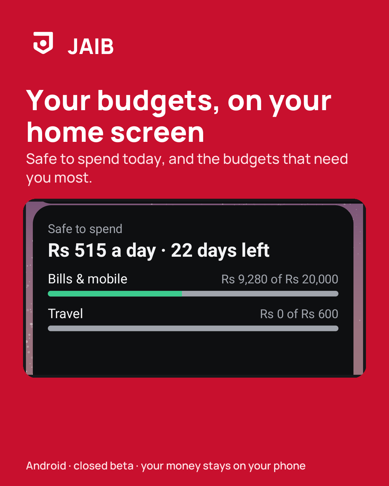
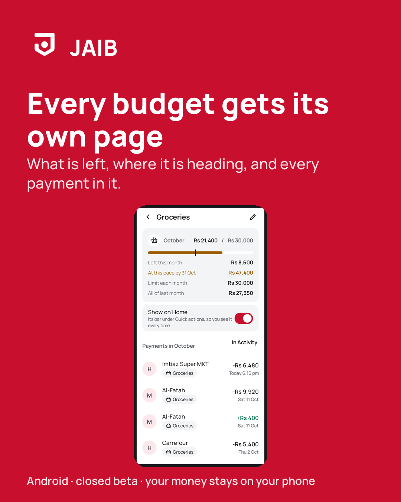
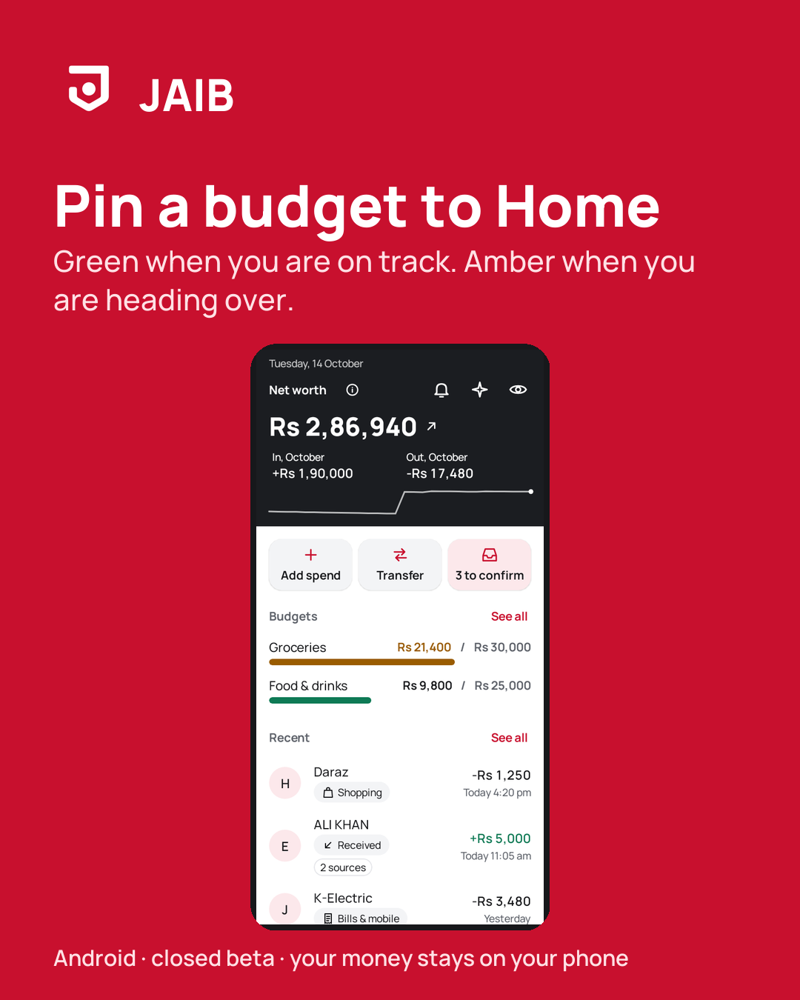
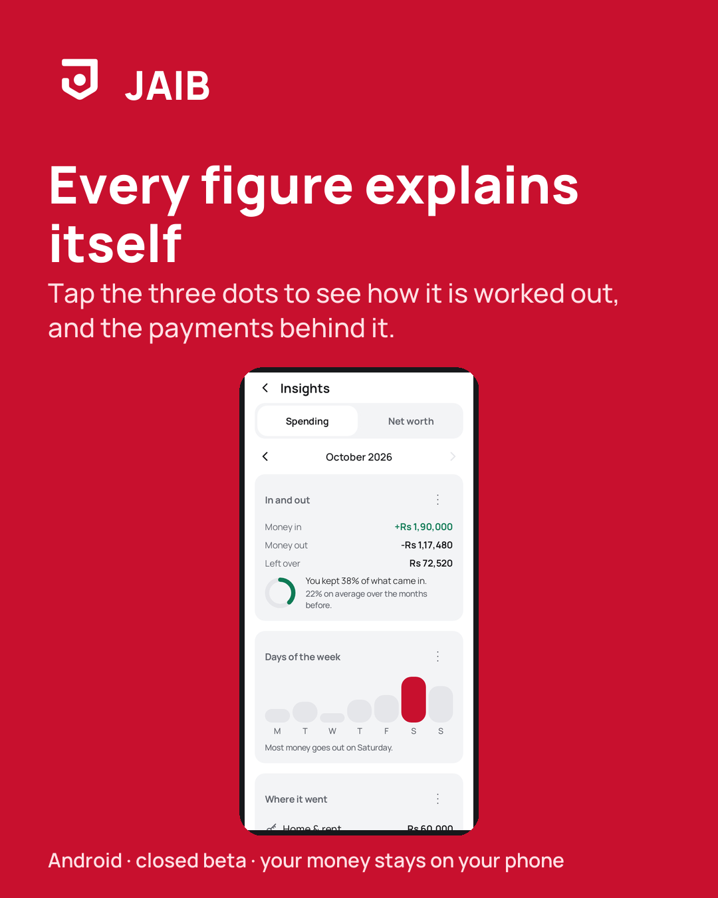
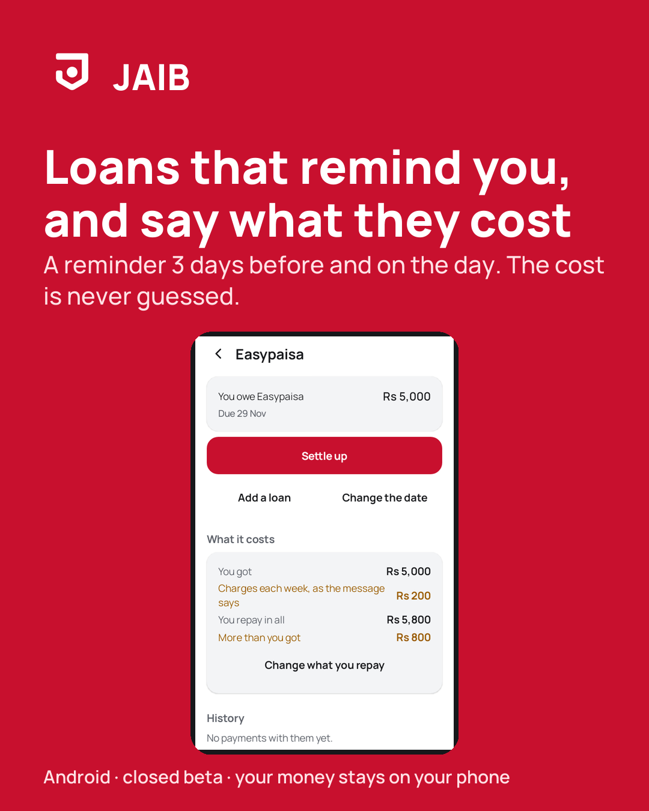

JAIB is a money app for Pakistan that reads your bank and wallet alerts on your phone and keeps the record there, encrypted. Nothing about your money leaves your phone.

This week's update is about seeing where you stand without doing sums:

1. A budget widget. Your home screen shows what is safe to spend today and the budgets that need you most: the ones already over first, then the ones heading over.
2. A page for every budget. What is left, where the month ends at this pace, and every payment in it. Pin a budget and it stays on Home, green when you are on track and amber when you are not.
3. Every figure explains itself. Each card in Insights now says how its number is worked out and shows the payments behind it.
4. Loans that remind you. A reminder three days before a loan is due and on the day. For a loan you took, JAIB shows what it costs from what the lender's message says and what you tell it. It never guesses.

One rule runs through all four: a figure on a widget, a page and a card is worked out in one place, so they can never disagree.

JAIB is in a closed beta on Android.

  
  
  
  
  

