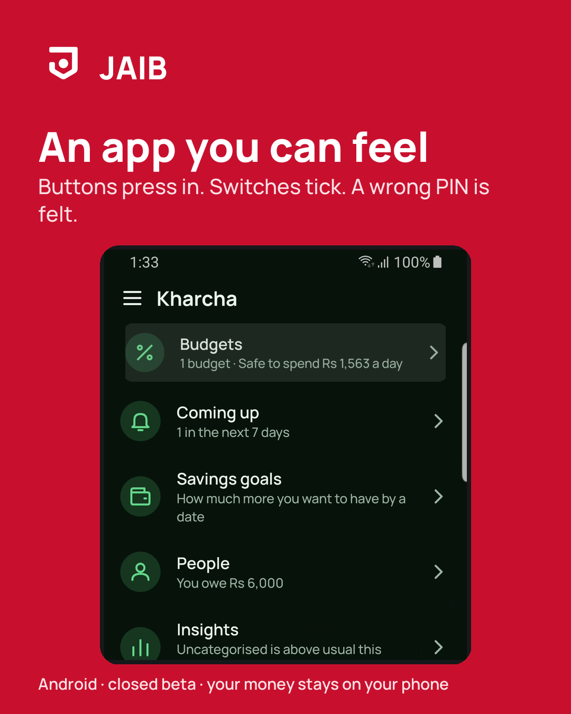
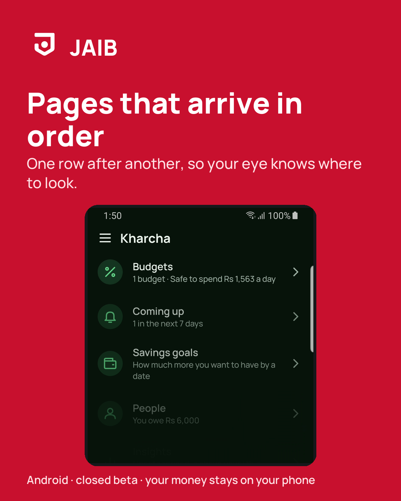
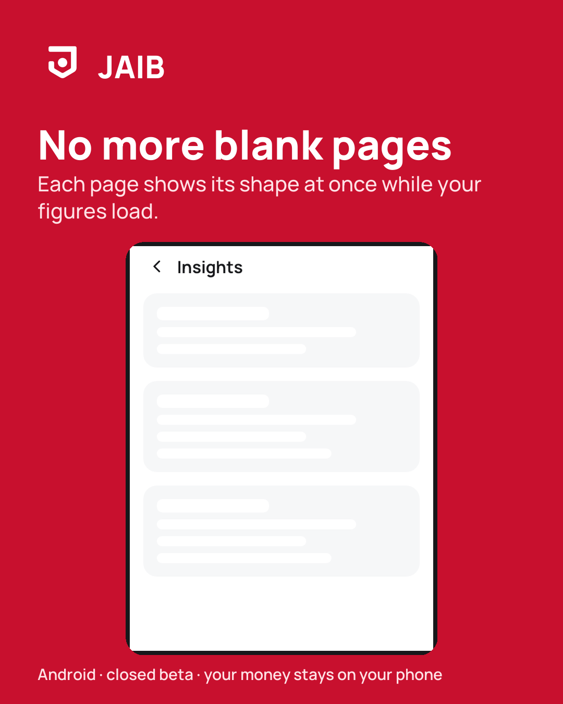

JAIB is a money app for Pakistan that reads your bank and wallet alerts on your phone and keeps the record there, encrypted. Nothing about your money leaves your phone.

1. It answers your thumb. Buttons and rows press in slightly when you touch them, switches give a small tick, and a wrong PIN is felt as well as seen.
2. Pages arrive in order. Kharcha and Budgets fill in one row after another, and when you hide a card the rest slide into place, so your eye follows what changed.
3. No more blank pages. While your figures load, each page already shows its own shape, so nothing jumps when the numbers come in.

Small details, but a money app is opened many times a day. It should feel calm and certain every time.

JAIB is in a closed beta on Android.

  
  
  

