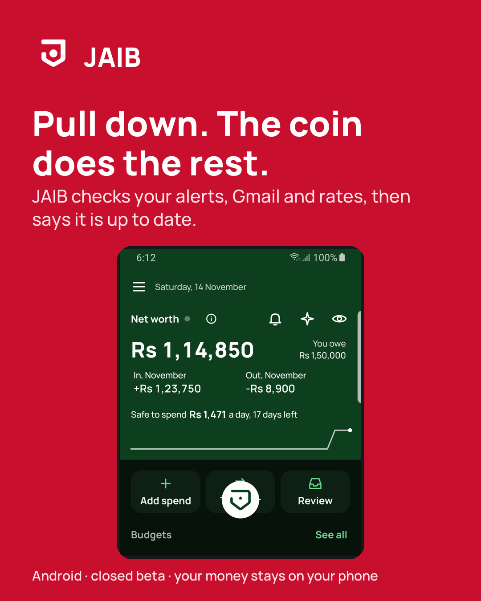
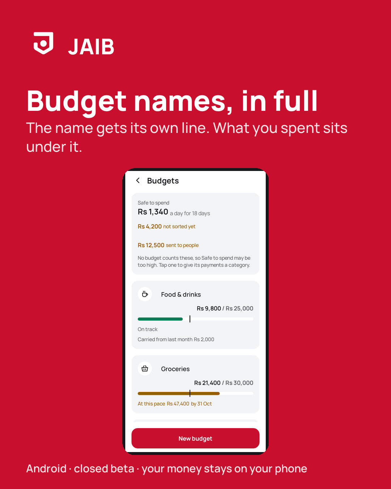
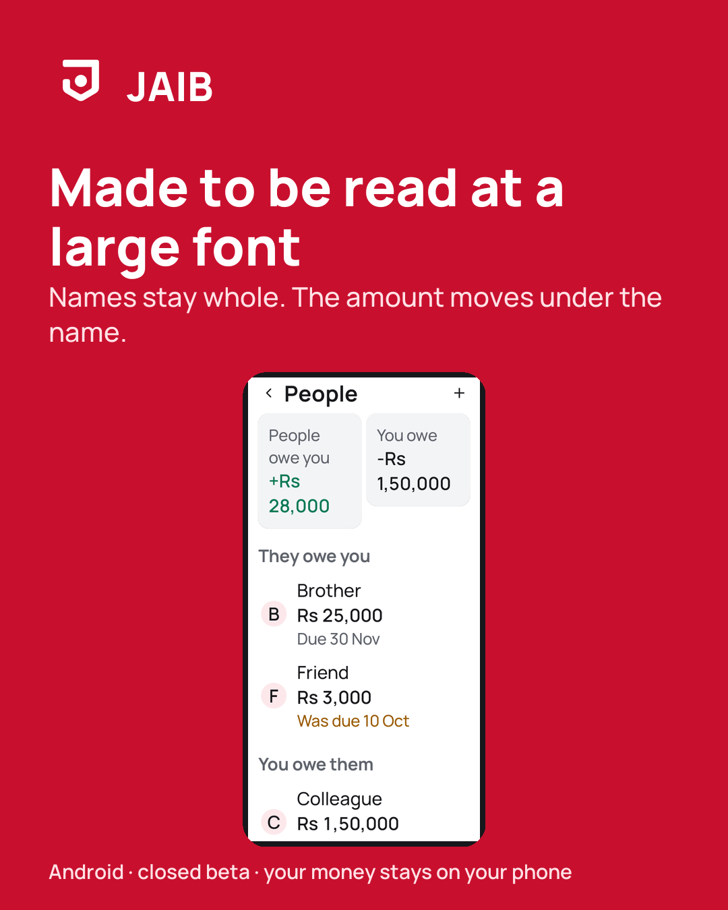

JAIB is a money app for Pakistan that reads your bank and wallet alerts on your phone and keeps the record there, encrypted. Nothing about your money leaves your phone.

1. Pull down to refresh, with our own coin. On Home, Activity and Accounts you pull the page down and the coin from our logo follows your finger into the pocket. JAIB checks your alerts, your Gmail and the exchange rates and tells you when it is up to date.
2. Budget names in full. A long name used to be squeezed beside its amounts. Now the name has its own line and what you spent sits under it.
3. Made for a large font. If your phone's font is large, amounts move under names on People, Coming up and Home, so no name is cut to a few letters.
4. Sheets that stay out of the way. The last line of a sheet no longer hides behind your phone's own buttons.

None of this is a new feature. It is the app getting easier to read and to use, which matters more.

JAIB is in a closed beta on Android.

  
  
  

