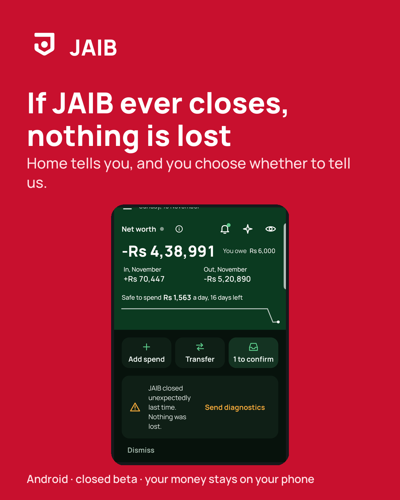
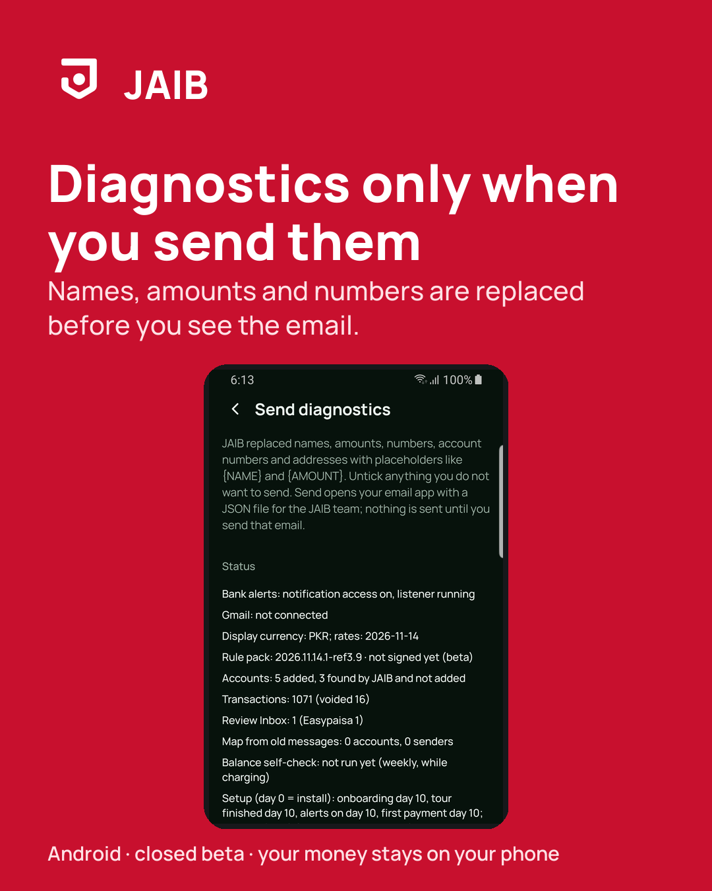

JAIB is a money app for Pakistan that reads your bank and wallet alerts on your phone and keeps the record there, encrypted.

1. Nothing missed. Some phones put apps to sleep to save battery. When JAIB starts again, it reads the bank alerts still waiting in your notifications and puts them in Review for you to check. They never go straight into your totals.
2. Nothing silent. If JAIB ever closes on its own, the next time you open it Home tells you, and that nothing was lost. You can send us diagnostics if you choose. Nothing is sent unless you do, and names, amounts and numbers are replaced before you even see the email.

JAIB is in a closed beta on Android.

  
  

