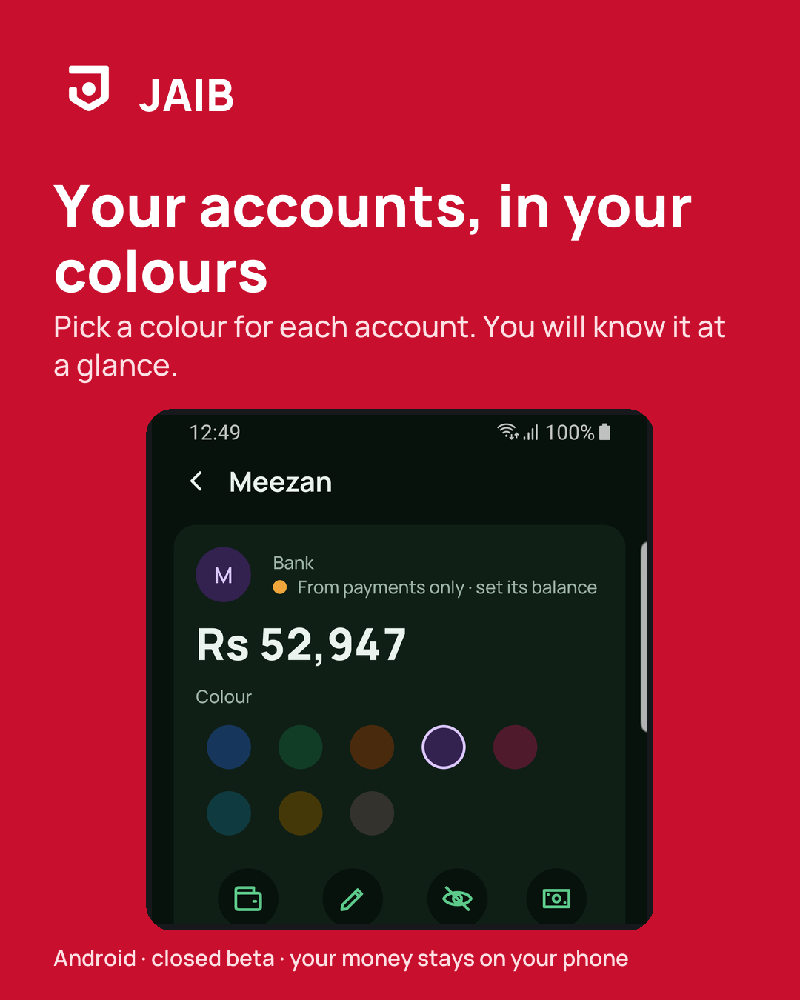
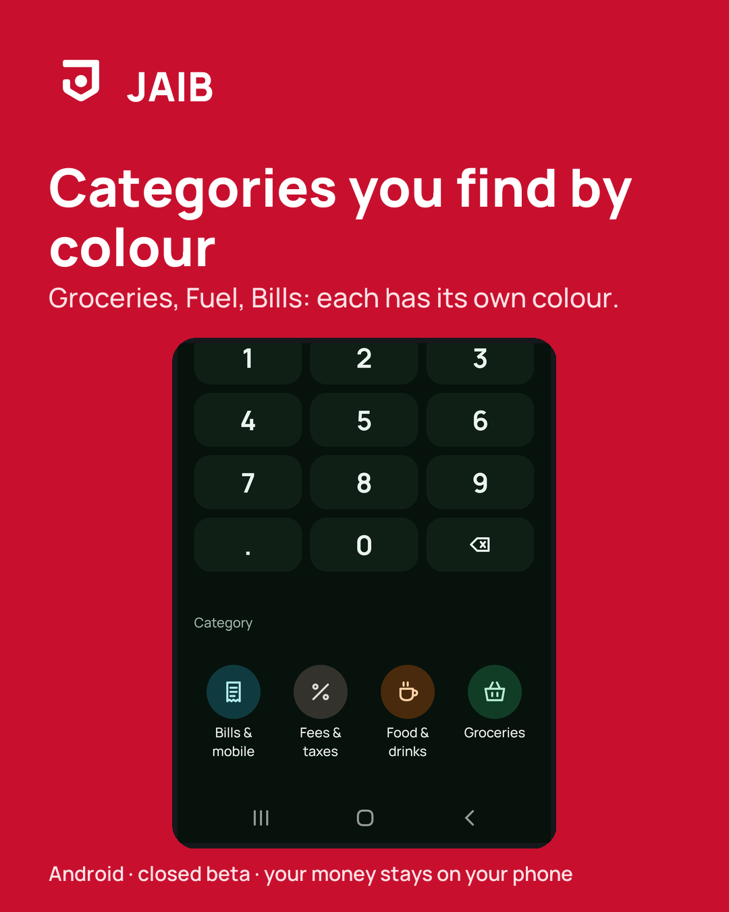

JAIB is a money app for Pakistan that reads your bank and wallet alerts on your phone and keeps the record there, encrypted.

- Pick a colour for each account, and know your HBL from your Easypaisa at a glance.
- Every category has its own colour, so Groceries or Fuel stand out without reading.
- A budget now opens as a page of its own, and the budget widget shows what fits when you make it smaller.

JAIB is in a closed beta on Android.

  
  

