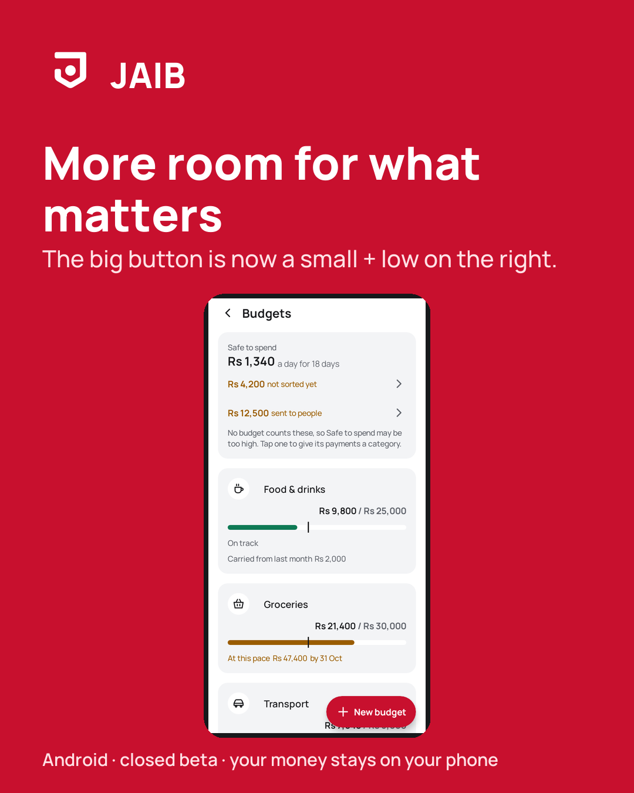
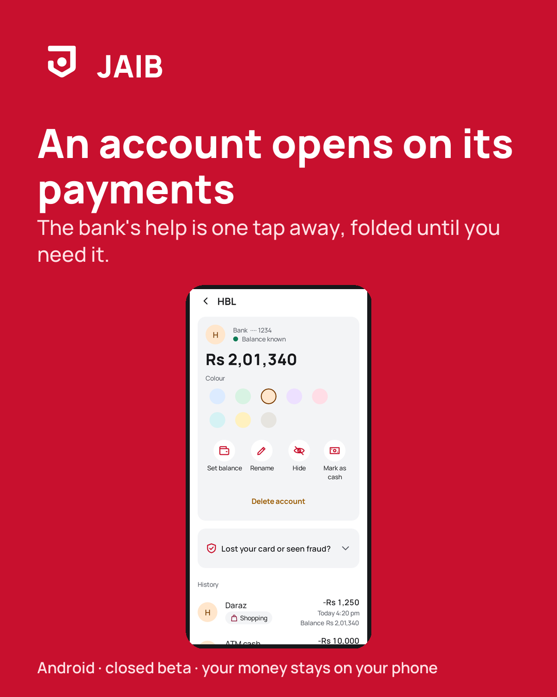

JAIB is a money app for Pakistan that reads your bank and wallet alerts on your phone and keeps the record there, encrypted.

- The big red button at the bottom of Budgets, Coming up and Goals is now a small + low on the right, so your list gets the screen.
- An account opens on its payments; the bank's help is folded, one tap away.
- Activity shows Month so far once, and every button looks like a button.

JAIB is in a closed beta on Android.

  
  

