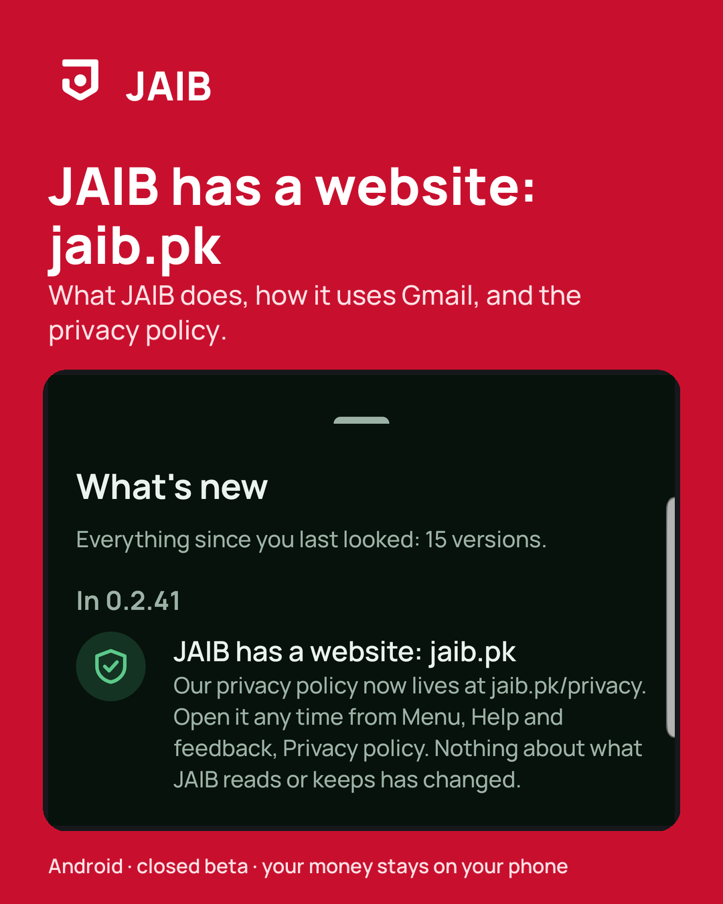

JAIB is a money app for Pakistan that reads your bank and wallet alerts on your phone and keeps the record there, encrypted.

- Our [privacy policy](/privacy/) now lives here on jaib.pk. In the app, open it from Menu, Help and feedback, Privacy policy.
- It says what JAIB reads, what it keeps and how to delete everything, including how JAIB uses Gmail.
- Nothing about what JAIB reads or keeps has changed, and nothing new leaves your phone.

JAIB is in a closed beta on Android.

  

