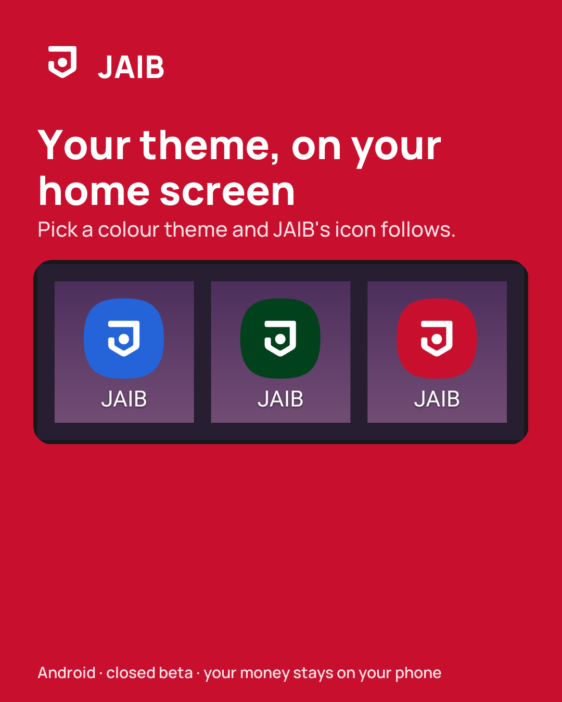
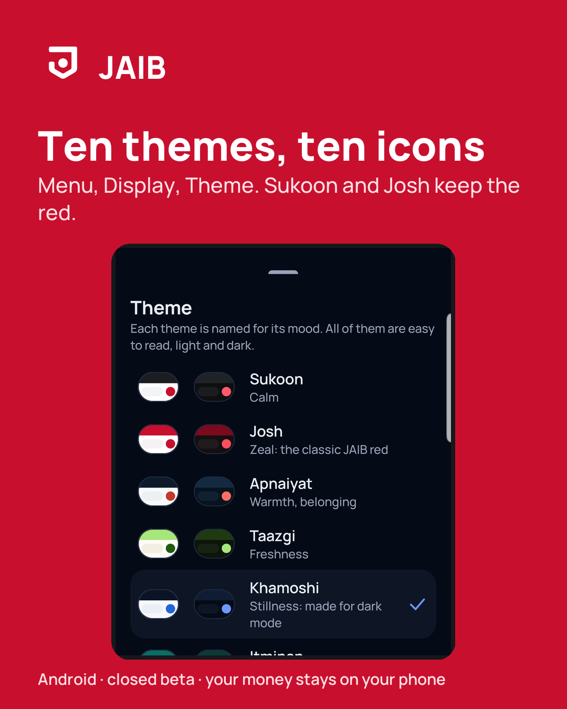

JAIB is a money app for Pakistan that reads your bank and wallet alerts on your phone and keeps the record there, encrypted.

- Pick one of JAIB's ten colour themes in Menu, Display, Theme, and the icon on your home screen follows: flag green for Fakhr, blue for Khamoshi, teal, indigo, orange and more.
- Sukoon and Josh keep the classic red.
- The icon changes when you leave JAIB, and stays where you put it on your home screen.

JAIB is in a closed beta on Android.

  
  

